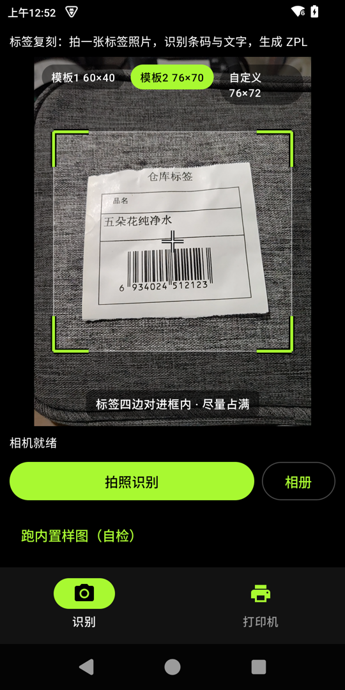
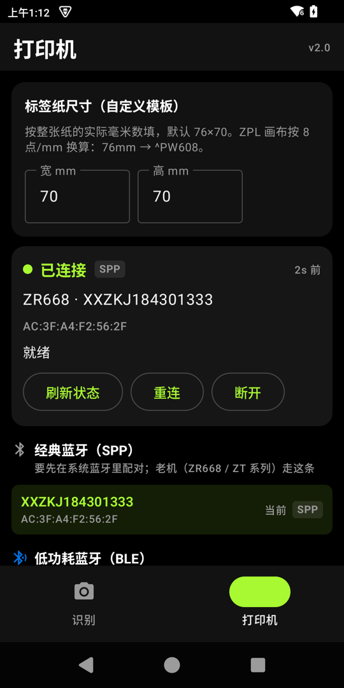
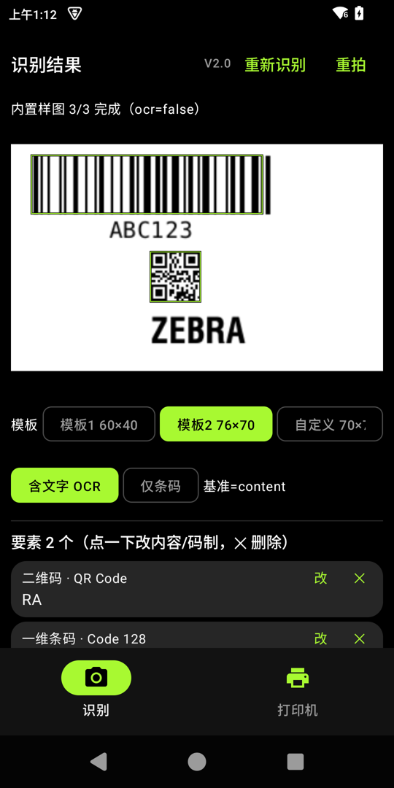

# V2.0 版本记录（2026-10-30）

> 主题：**标签复刻走通"生成 → 打印 → 再识别"闭环**。框线、码制、字号、纸尺寸四件事全部落地，
> 相机路径从"能用但一堆碎线"改为"与相册路径同一品质"。

## 1. 为什么是 V2.0

V1.x 的输出只做到"文字 + 条码"，**框线从来没进过 ZPL**：`ElementKind` 里没有 `LINE/BOX`，
`ZplBuilder` 也不发 `^GB`。用户打出来的标签缺外框、缺分隔线，等于"复刻了个半成品"。
V2.0 把框线补成一等公民，同时纠正了三条从 V1.x 一路带错的几何假设（见第 3 节）。

## 1.5 界面（真机截图，2026-10-30，TC201L）

**拍照页** —— 取景绿框 + 模板 chip（`模板1 60×40` / `模板2 76×70` / `自定义`）+ 拍照/相册/自检：



**打印机设置页** —— 顶部「标签纸尺寸（自定义模板）」卡片（V2.0 新增，尺寸在这里改）+ 打印机状态卡片：



**识别结果页** —— 模板 chip 可直接切、含文字OCR/仅条码开关、要素可点一下改内容/码制、右上角版本号 `V2.0`：



> 截图取自内置样图自检（`跑内置样图（自检）`），所以照片区显示的是 ZEBRA 测试图；相机路径的实际输出见第 4 节。

## 2. 逐项改动

### 2.1 码制（P0，影响所有条码字节）

| 项 | V1.9 | V2.0 |
|---|---|---|
| EAN-13 | 一律发 `^BC`（Code 128） | 发 `^BE`，模块数按固定 95 |
| 其它 | Code128 / Code39 | `^B8` EAN-8、`^B9` UPC-A、`^B0` UPC-E、`^B2` ITF、`^B3` Code39、`^BA` Code93、`^BK` Code11 |

- `_FIXED_MODULES = {ean13: 95, upca: 95, ean8: 67, upce: 51}` —— 旧逻辑按 Code128 的
  `11×符号数+35 = 112` 估宽度，模块宽被压小约 15%，打出来扫不动。
- 根因不在识别（zxing-cpp 复核一直是 `EAN-13 / 6934024512123`），而在**发射层把码制丢了**。

### 2.2 框线

- `ElementKind.BOX` 新增；`ZplBuilder` 发 `^FO x,y ^GB w,h,th ^FS`。
- 厚度：**统一 5 点（0.63mm）**。实测 3 点打出来发虚，下一张照片更难检出，会形成
  "细线 → 更难点 → 更细"的恶性循环；上限也压到 5，再粗会把 3 点笔画糊成色块。
- 校验器：`^FD + ^GB == ^FS`（只比 `^FD` 会误报"不配对"）。

### 2.3 字号

- 双约束取小：`size = min(墨迹高 / 字高比, 墨迹宽 / (推进宽 × 0.92))`；OCR 行框比字形胖 10~20%，不能直接用行高。
- **整体 ×1.15**：实测双约束偏保守，整版小一号。
- **文字基线 +12 点（1.5mm）**：原式 `lines × 字号` 让整版文字偏高，压到上一条分隔线上方。
  只动文字，不碰框线/条码。

### 2.4 纸张尺寸（用户实测纠正）

- 真实纸张 **76 × 70 mm**（不是 70×70）。203dpi → 8 点/mm → **608 × 560 点**，ZPL 头 `^PW607`。
  旧版按 559×559 出图，横向压缩 8.6%、整体偏左约 0.6mm。
- 印刷框真值 **63.2 × 46.6 mm，ar = 1.357**（旧的 1.25 是横向压缩造成的假值）。
- 用户补充的关键前提：76mm 是**整张纸**宽度，可打印宽度小于纸宽，四周留白正常。

### 2.5 模板3 = 「自定义」

- 模板表里 3 号改为 `自定义`（默认 76×70），尺寸由用户填；
- 输入入口放在**打印机设置页顶部**「标签纸尺寸（自定义模板）」卡片（宽mm / 高mm）；
  拍照页那两块输入框盖在取景框上、实际点不到，已删除；
- 写进 `ZplGeometry.TEMPLATES[3]` 而不是加分支 —— `aspectOf` / chip 文案 / 布局 / ZPL 画布
  全线自动跟随；
- 持久化到 SharedPreferences（`label/customW`、`customH`），重开 App 读回。

## 3. 三条被推翻的几何假设

| 假设 | 实际 | 后果 |
|---|---|---|
| 纸 70×70、ar=1.0 | 76×70、ar=1.086 | 横向压缩 8.6% |
| 锚点用纸边 | 纸是撕开的，ar 在 0.51~1.27 乱跳 | 整版偏移十几毫米 |
| 四边形偏大没关系 | 它常贴着**内容**而非纸边（ar 1.234 vs 1.086） | 纵向少抓 8mm 空白，内容下移 30 点、下边框掉出画面 |

对策：

1. **纸张长宽比当已知常量**：`basis=="label"` 且检出比例偏差 >3% 时，纵向按比例拉开、保持中心；
2. **纸边禁区 6%**：印刷框离纸边 ≥9% 留白，贴边的线一律不当框线（修"纸下边缘被当成下框线"）；
3. **长横线豁免**：条码的条都是竖直的，宽度 ≥25% 版面的横线不参与条码/HRI 排除区
   （修"下边框被条码排除区吃掉"）。

## 4. 相机路径

- 四点定位 v4：长直线两两组合候选矩形 → 面积**升序**取第一个长宽比符合模板的
  → 四条边最小二乘拟合求交 → 透视拉正。抓不到时退回纸边/整帧。
- 条码排除区向下延伸到 `0.55 × 条高`（HRI 数字贴条码下沿，再长就会吞掉下边框）。
- 文字 bbox 只排除**短线**（整根边框压在某个文本框上是常态）。
- 内容框 `basis` 只按 TEXT+BARCODE 算；短于跨度 8% 的一律不当线。

## 5. 修掉的两个自身故障（教训）

1. **启动即崩**：自定义尺寸的 prefs 读取写在 `init { }` 里 —— Activity 在 `attachBaseContext`
   之前构造，`getSharedPreferences` 的 context 是 null。挪进 `onCreate`。
2. **首页黑屏**（只剩底部两个图标）：脚本删"拍照页输入框"时范围算错，把
   `else if (screen == "result") { ResultPane }` 和 `else { CameraPane }` 整段删掉，
   `if (tab == 1)` 没有 else 分支 → tab=0 时 Box 里什么都不画。用 `git show HEAD:` 还原。

> 结论：**大范围文本增删必须先用 `git diff` 确认删除范围再编译**，UI 结构改动前后各拍一张截图对照。

## 6. 交付与验证

- APK：`android-app/app/build/outputs/apk/debug/app-debug.apk`，`adb install -r -t` → `Success`
- 真机：TC201L，serial `26141525100772`；启动 `FATAL EXCEPTION` 计数 0；首页截图确认
  预览/取景框/模板 chip/拍照·相册/底部两 tab 齐全
- 打印机：ZR668 `192.168.28.90:9100`，`^PW607 ^LL559`，外框 `x=56~562, y=111~484`，分隔线 `y=188 / 283`，5 点线宽
- 用户终验：**"现在都ok了"**（框体 6 条线、文字位置、条码码制、纸尺寸自定义）

## 7. 遗留

1. **细线在斜拍下漏检**：逐行扫描时 2° 倾斜只剩约 86px 连续暗像素，低于 350px 门槛就被丢。
   正解是 **Hough 变换**（安卓 OpenCV 现成有）。当前用"输出固定 5 点线宽"绕过（打粗 → 下次好认）。
2. **纸边四边形仍偏大**：靠长宽比校正兜着，不是根治。
3. `--es testImage` 优先级问题未修：日志图名一直是内置自测图，端侧无法脚本化验证推送照片。
4. `tools/regress.py` 的基线（250/218/345 那组字节数）已被 P0 改动改变，**需要重录**。
5. 标注：`eval_quads.py` 仍有 `warp_and_measure(..., scale_back)` 签名 bug 未修。

## 8. 复现命令

```bash
cd E:/workspace/label-reprint-android/android-app
./gradlew.bat assembleDebug -q --console=plain
adb install -r -t app/build/outputs/apk/debug/app-debug.apk

# 端侧结果
adb logcat -d -s LABELREPRINT:* | grep -E "FRAME >>>|PLAN >>>|ZPL >>>"

# PC 参考实现（同一套算法）
python tools/label_to_zpl.py <图片> --template 2
```
