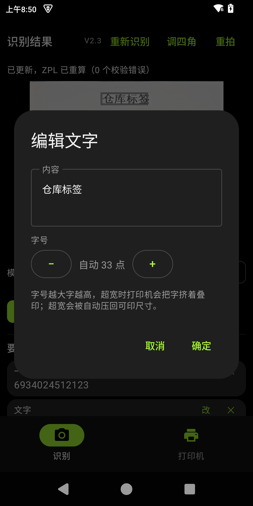
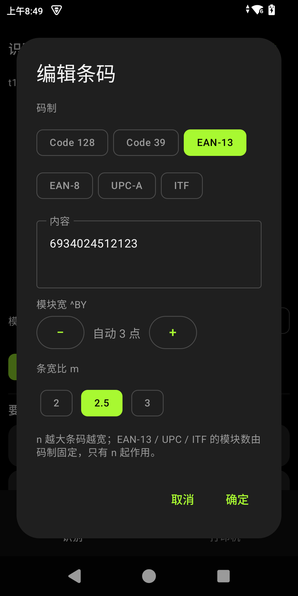
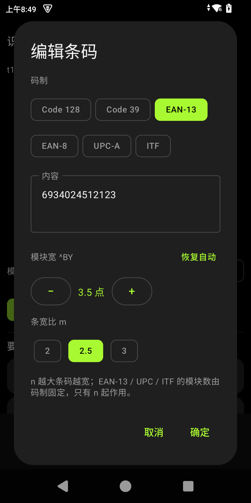

# V2.3 版本记录（2026-11-02）

> 主题：**要素编辑支持「字号」与「条码缩放」**。改完不用重新识别，ZPL 立即重算。
> 同时补记 V2.1 / V2.2 两轮（四点标定、放大镜、Hough 框线），此前没有单独建档。

## 1. 为什么要有 V2.3

V2.2 之前，编辑弹窗只能改**内容**和**码制**。但复刻一张旧标签，光改字不够：

- 原标签的字是 8mm 高的标题，识别回来按墨迹算出 33 点（≈4mm），想放大到 5mm —— 做不到；
- 原标签的条码模块宽 5 点，识别出来按原图推算只有 3 点，打出来偏窄、有些扫码枪读不稳 —— 也改不了；
- 用户唯一的办法是"改回电脑上用 BarTender 调"，等于这个工具在最关键的一步掉链子。

V2.3 把这两件事做成两步之内可改：文字给字号、条码给 `^BY n,m` 的缩放。

## 2. 界面（真机截图，TC201，1080×2160）

**文字 —— 编辑文字**：内容框下面是「字号」步进器，显示当前自动值，`−` / `+` 每次 2 点：



**条码 —— 编辑条码（自动态）**：码制 6 个 chip（放不下自动换行），内容，然后是「模块宽 ^BY」与「条宽比 m」：



**条码 —— 手动态**：点 `+` 之后数值变绿、右上出现「恢复自动」，一键退回按原图推算：



## 3. 逐项改动

### 3.1 数据模型（`model/LabelElement.kt`）

| 新字段 | 含义 | 0 值的语义 |
|---|---|---|
| `fsOverride: Int` | 字号（打印点），只对 TEXT | 按墨迹自动算 |
| `byN: Float` | `^BY` 的 n（模块宽，点），只对 BARCODE_1D | 按原图推算 |
| `byM: Float` | `^BY` 的 m（条宽比） | 默认 2.5 |

### 3.2 生成器（`zpl/ZplBuilder.kt`）

- `^BY` 的 m 原来**硬编码 2.5**，改成参数 `barcode1dField(..., ratio)` —— 否则界面上改了 m、ZPL 里还是 2.5。
- 三条覆盖规则，都是"用户值优先、自动值兜底"：
  - 条码：`mw = if (byN>0) byN else 自动`；`ratio = if (byM>0) byM else 2.5`；
  - 文字：`fs = if (fsOverride>0) fsOverride else autoFontSize(e, w)`；
  - **宽度硬兜底保留**：用户设的字号超宽时压回可印尺寸，并给警告
    「字号 63 会让「xxx」超宽（370 点字段），已按 48 点输出」—— 宁可小一号，绝不让打印机叠印。

### 3.3 自动值只留一份（`zpl/ZplGeometry.kt`）

新增 `autoFontSize(e, labelW)` / `autoModuleWidth(e)`，**生成器与编辑弹窗共用**。

弹窗要显示「自动 33 点」让用户在此基础上加减；如果两处各写一套公式，迟早漂移 ——
用户会看到"弹窗里写 33、纸上打 37"，这比没有这个功能更糟。

### 3.4 排序陷阱

一次弹窗确认可能要下发 3 个改动（内容 / 码制 / 字号）。`applyEdit` 每次都整表重排，
所以顺序必须是"先内容与码制、后字号与缩放"；反过来的话，后一次 `copy()` 会把前一次的
改动覆盖掉（少带一个字段就静默丢失）。

### 3.5 顺带修的两个弹窗排版问题

| 现象 | 根因 | 修法 |
|---|---|---|
| 一维码第 4~6 个码制 chip 被裁在弹窗外（EAN-8 看不见） | 6 个 chip 用 `Row` 硬排，一行放不下 | 改 `FlowRow` 自动换行 |
| 「自动」按钮被挤成一字宽的竖排「自／动」 | `标签 + − + 值 + + + 自动` 全塞一行，末尾只剩一个字宽 | 步进器改两行：上行「标签……恢复自动」，下行「− 值 +」 |

## 4. 真机验证（逐条，都是日志原文）

| 用例 | 结果 |
|---|---|
| 文字自动字号 | `^A@N,33,33` ←→ 弹窗显示「自动 33 点」 |
| `+` 两次后确定 | `^A@N,37,37`，锚点 86 → 90（= 字号 + 12 基线补偿） |
| 恢复自动 | 回到 `^A@N,33,33`，锚点 86 |
| 条码模块宽 3 → 3.5 | `^BY3,2.5,71` → `^BY3.5,2.5,71` |
| 条宽比 2.5 → 3 | `^BY3.5,3,71` |
| **编辑是否只改该改的** | 全 ZPL 15 行，只有 `^BY` 那一行变；条高 71、位置 391、其余要素全不动 |
| 多次编辑是否累积 | 先改条码再改字号，`^BY3.5` 与 `^A@N,37` 同时留在最终 ZPL 里 |
| remap 幂等性 | `ZPL` 与 `ZPLR`（识别后原样重排一次）逐行完全相同 |
| 打印回归 | `device_zpl_check.py` → `mismatches: 3`，与改动前基线一致（差异性质见第 6 节） |

## 5. 新增的两个调试口

```
--es remap 1        # 识别完把结果原样 remap 一次，打 ZPLR >>>；用来验证"布局是否幂等"
--es scaleedit 3.5  # 对第一个条码直接下发 ^BY n，不点 UI 也能回归编辑链路
```

编辑后日志固定打两条：`EDIT >>> TextSize #1` + 完整 `ZPLE >>>`（含 warnings）。
以后查"字号/缩放到底进没进 ZPL"，不用再靠肉眼比对界面。

## 6. 回归基线（重要，别再误判）

`tools/device_zpl_check.py` 固定 3 个 FAIL（exit code 1），三张内置样图与 PC 参考实现的差异是**已知的**：

| 样图 | 差异 | 性质 |
|---|---|---|
| `label_sample_2` | PC 发 `^BY4.693069306930693`，安卓取整成 `^BY4.5` | 模块宽取整口径 |
| `label_sample_1` | 条高 87 vs 83、x 0 vs 12 | 裁切/基准的小差 |
| `label_sample_3` | 条高 75 vs 115、QR mag 3 vs 5 | PC 的 `paper_quad`(minAreaRect) 与真机四点裁切不同，基准选到不同档 |

"3 处差异全是取整"是错的：只有第 2 张是取整，第 3 张是**版面档位**不同。
判断"编辑功能有没有搞坏生成器"的正确依据，是 `ZPL` vs `ZPLR` 的逐行 diff，不是这个 mismatch 数。

## 7. V2.1 / V2.2 补记（此前无档）

- **V2.1**：结果页「调四角」→ 手动四点标定（`QuadCropPane` 重写，`BoxWithConstraints` + `nativeCanvas`）；
  拖动定位点时浮出 132dp 放大镜（3× 放大、从原图 `drawImage` 取局部、青色十字 + 白靶心）。
- **V2.2**：标定页支持"点图片放角点 ①→④"（此前只能拖圆点，用户点四角等于没操作 —— 输出仍是默认 8% 框，
  这是他报的"四点已定位但不是我要的区域"的真正原因）；`LabelFrame.quadProblem()` 四点自检
  （凸性/自交/凹陷/面积），不合法直接拦截。
- **框线改 Hough**（含在 2.2 里）：14 张现场照片（纸箱/木桌/托盘/白纸）**11 张精确 4 横 2 竖**，
  单张 420~590ms；条码上下沿用 `excludePx` 剔除；找不到线返回空，不回退旧启发式
  （旧实现在 224147 上吐 71 个要素）。
- **放大镜残留 bug**：拖住圆点 → 切 tab → 切回，浮层不消失。根因是"幽灵指针"让重建后的面板
  又进了拖动，`onDragEnd/onDragCancel` 都不给。修法：拖动采样打时间戳 + 3 秒无采样强制复位。

## 8. 遗留

1. **二维码缩放未开放**：1D 走 `^BY`，二维码走 `^BQ` 的 mag，语义不同，本轮没做；
   弹窗里二维码仍只有内容可改。
2. **条高不可调**：`^BY` 的第三个参数（条高）跟着元素框高走，用户想单独加高条码做不了。
3. **手册截图仍是 V2.2**：`manual/标签复刻App使用手册.html` 里 8 张截图右上角写的是 V2.2；
   功能没变，但版本号对不上，重拍一次即可。
4. **字号步进 2 点**：203dpi 下 1 点 ≈ 0.125mm，2 点一档够用；真要 1 点级微调得改成输入框。

## 9. 复现命令

```bash
cd E:/workspace/label-reprint-android/android-app
./gradlew.bat :app:assembleDebug
adb install -r app/build/outputs/apk/debug/app-debug.apk

# 走真实识别链路 + 直接下发 ^BY
adb shell am start -n com.tiaomabang.labelreprint/.MainActivity \
  --es testImage /sdcard/Android/data/com.tiaomabang.labelreprint/files/t1.jpg \
  --es ocr 1 --es scaleedit 3.5

# 看编辑后的 ZPL（ZPLE）与识别时的原始 ZPL（ZPL）逐行对比
adb logcat -d -s LABELREPRINT | grep -E "EDIT >>>|ZPLE >>>|^..-.. .*LABELREPRINT: \^"
```
